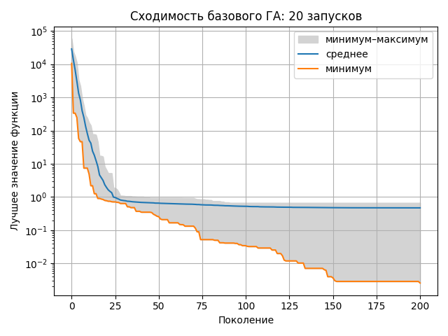
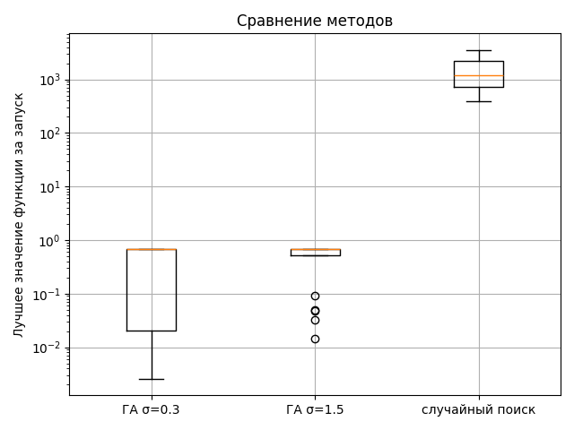

# Лабораторная работа № 1

## Генетический алгоритм для функции Диксона—Прайса

Дисциплина «Эволюционное программирование и генетические алгоритмы». Вариант 9, размерность 8. Программа написана на Python 3. Функцию, генетический алгоритм и случайный поиск реализовал самостоятельно; NumPy используется для генерации случайных чисел, Matplotlib — для графиков.

## 1. Задача

Нужно найти координаты восьмимерной точки, на которой функция Диксона—Прайса принимает наименьшее значение:

$
\min_{x \in [-10,10]^8} f_9(x), \qquad
f_9(x) = (x_1 - 1)^2 + \sum_{i=2}^{8} i(2x_i^2 - x_{i-1})^2.
$

Функция не бывает отрицательной, потому что состоит из квадратов с положительными коэффициентами. Её глобальный минимум равен нулю. Один из векторов, на котором он достигается:

$
x^* \approx (1,\ 0.70711,\ 0.59460,\ 0.54525,\ 0.52214,\ 0.51095,\ 0.50542,\ 0.50269).
$

У этого вектора координаты удовлетворяют условиям $x_1=1$ и $2x_i^2=x_{i-1}$ для $i=2,\ldots,8$. Последняя координата может иметь любой знак, поскольку входит в формулу в квадрате.

Границы поиска заданы условием $-10 \leq x_i \leq 10$ для каждой координаты.

## 2. Представление решения и алгоритм

Одна особь — список из восьми вещественных чисел. Популяция содержит 60 особей. В начале координаты каждой особи случайно выбираются из отрезка $[-10,10]$.

На каждом шаге программа считает значение функции для особей и оставляет две лучшие без изменений. Остальные 58 мест занимают новые потомки:

1. Для выбора родителя проводится турнир: случайно выбираются три особи, побеждает особь с меньшим значением функции.
2. С вероятностью 0.9 два родителя скрещиваются оператором BLX-$\alpha$ с $\alpha=0.5$. Для каждой координаты потомка случайно выбирается число из расширенного отрезка между координатами родителей.
3. Каждая координата потомка с вероятностью 0.125 меняется на случайную величину с нормальным распределением и средним 0.
4. Если координата вышла за границы $[-10,10]$, она заменяется ближайшей границей.

При отсутствии скрещивания потомок начинает с копии первого родителя. Мутация после этого всё равно возможна.

По умолчанию средний размер изменения координаты равен $\sigma=0.3$. Во второй конфигурации используется $\sigma=1.5$. Эти настройки отличаются только масштабом мутации.

Выполняется 200 поколений. Для начальной популяции нужно 60 вычислений функции, затем по 58 новых вычислений на поколение. Всего на один запуск приходится $60+200\cdot58=11660$ вычислений. Значения элитных особей повторно не считаются.

## 3. Почему поиск сложный

В формуле каждая координата связана с предыдущей: для малого значения функции должно выполняться $2x_i^2 \approx x_{i-1}$. Поэтому удачное решение требует согласованно подобрать цепочку из восьми координат.

Точка $(1/3,0,\ldots,0)$ имеет значение функции $2/3$ и нулевой градиент, но не является локальным минимумом: существуют близкие точки с меньшим значением. Это стационарная точка, рядом с которой поиск может замедлиться. Чтобы продолжить улучшение, нужно изменить связанные координаты согласованно.

Случайный поиск не использует информацию о том, какие точки оказались удачными. В восьмимерном кубе $[-10,10]^8$ при ограниченном числе проб ему трудно случайно выбрать координаты, образующие нужную цепочку.

## 4. Проведённые эксперименты

Проведены три серии по 20 запусков. Для запусков с одинаковым номером использовались одинаковые seed от 1000 до 1019. Во всех сериях бюджет составлял 11660 вычислений функции на один запуск.

1. Генетический алгоритм с $\sigma=0.3$.
2. Генетический алгоритм с $\sigma=1.5$.
3. Случайный поиск: 11660 равномерно выбранных точек в той же области.

В таблице приведено лучшее значение функции, найденное в каждом запуске; сводные показатели рассчитаны по 20 запускам.

| Метод | Лучшее | Среднее | Медиана | Стандартное отклонение | Худшее |
| --- | ---: | ---: | ---: | ---: | ---: |
| ГА, $\sigma=0.3$ | 0.00256 | 0.470 | 0.667 | 0.309 | 0.667 |
| ГА, $\sigma=1.5$ | 0.0143 | 0.515 | 0.669 | 0.277 | 0.675 |
| Случайный поиск | 387 | 1494 | 1175 | 925 | 3545 |

В шести запусках базовой конфигурации и в пяти запусках с $\sigma=1.5$ результат оказался меньше 0.1. В остальных запусках ГА остановился около 0.667. Лучший результат получен базовой конфигурацией при seed 1004:

$
x \approx (0.982,\ 0.694,\ 0.585,\ 0.534,\ 0.521,\ 0.512,\ 0.507,\ 0.502),
\qquad f_9(x)=0.00256.
$

Этот вектор близок к точке глобального минимума. В некоторых успешных запусках последняя координата оказалась близка к $-0.5$; это также допустимо из-за её квадрата в последнем слагаемом.

Случайный поиск дал лучший результат 387. Генетический алгоритм оказался значительно точнее при том же числе вычислений функции. В этой серии меньший масштаб мутации дал лучший результат и меньшее среднее, хотя медианы двух вариантов ГА близки.

## 5. Графики

На графике сходимости показаны минимум, среднее и максимум лучшего значения функции среди 20 запусков базовой конфигурации на каждом поколении. Серая область обозначает диапазон от минимума до максимума. Вертикальная ось логарифмическая.



На диаграмме ниже сравниваются финальные значения функции в трёх сериях. Линия внутри каждого прямоугольника показывает медиану.



## 6. Вывод

Генетический алгоритм справился со случайным поиском заметно лучше при одинаковом бюджете. Из двух проверенных настроек масштаб мутации 0.3 дал лучший результат. При этом алгоритм не всегда подходит близко к глобальному минимуму за 200 поколений: во многих запусках он надолго задерживается около значения 0.667. Поэтому результат зависит от seed, и его качество важно оценивать по серии запусков, а не только по одному удачному примеру.

## 7. Повторный запуск

Все файлы для повторения экспериментов находятся в этой папке. Из `lab1` установите зависимости и выполните:

```bash
python3 -m tests.test_function
python3 -m src.experiment
```

Первая команда запускает проверки. Вторая повторяет три серии, обновляет таблицы и сохраняет графики в `results/`. Настройки алгоритма находятся в `configs/`, число запусков — в начале `src/experiment.py`.
